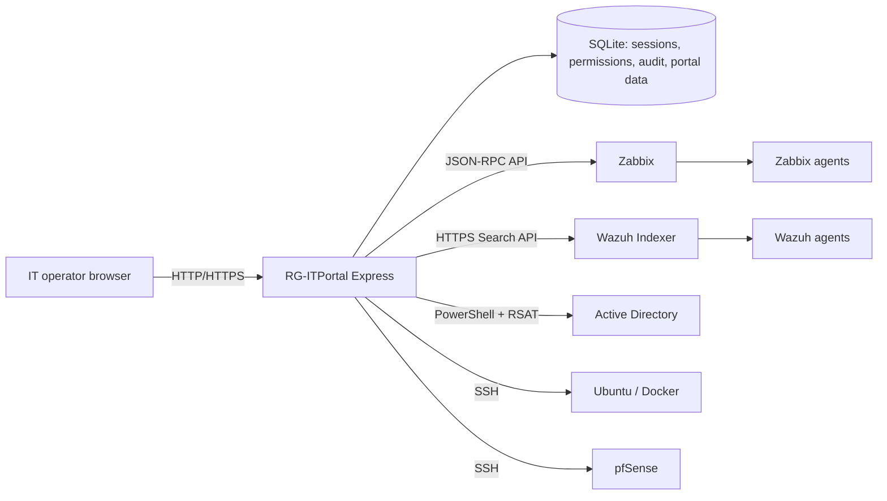

# Kiến trúc và thiết kế

## Mục tiêu

RG-ITPortal cung cấp một giao diện nội bộ để xem tình trạng hạ tầng, security alerts và thực hiện một số thao tác quản trị có phân quyền. Các hệ thống chuyên dụng vẫn là nguồn dữ liệu chính; Portal gọi API/SSH/PowerShell và tổng hợp kết quả cho người vận hành.

## Sơ đồ thành phần

## Thành phần và trách nhiệm

| Thành phần | Trách nhiệm | Giao thức / dữ liệu |
|---|---|---|
| `public/` | Dashboard, trang Zabbix/Wazuh, AD, Docker, helpdesk, tài sản, lỗ hổng và báo cáo | Browser gọi `/api/...` |
| `server.js` | Express app, session, middleware bảo vệ, SQLite và route registration | HTTP(S), SQLite |
| `routes/monitoring.js` | Lấy host/problem/event và dữ liệu alert từ Zabbix | Zabbix JSON-RPC |
| `routes/security.js` | Truy vấn Wazuh alerts theo truy vấn đọc | Wazuh Indexer HTTPS API |
| `routes/ad*.js` | Đăng nhập và thao tác AD theo vai trò | Windows PowerShell/RSAT |
| `routes/docker.js` | Đọc trạng thái và một số thao tác container/stack | SSH, Docker CLI trên Linux |
| `routes/perm.js`, `routes/auth.js`, `routes/login-guard.js` | Vai trò, phiên, giới hạn đăng nhập, kiểm tra quyền | AD groups, SQLite session/audit |
| SQLite | Phiên, quyền tùy chỉnh, audit và dữ liệu cục bộ của Portal | File DB cạnh app mặc định; WAL |

## Luồng dữ liệu

1. Người dùng đăng nhập; trên Windows, Portal xác thực thông tin qua AD.
2. Portal tạo session có lưu bền trong SQLite. Các route kiểm tra session và quyền trước khi trả dữ liệu hoặc chạy thao tác.
3. Dashboard yêu cầu dữ liệu từ các API nội bộ. Route tương ứng truy vấn hệ thống tích hợp, chuẩn hóa kết quả và báo lỗi nguồn khi không kết nối được.
4. Zabbix và Wazuh tiếp tục thu nhận dữ liệu từ agent; Portal không thay vai trò của hai hệ thống này.
5. Thao tác được phép được gửi xuống AD/Docker/pfSense qua công cụ quản trị tương ứng; các API thay đổi có thể ảnh hưởng hệ thống thật, nên thử Lab trước.

## Ranh giới và giả định

- Portal là ứng dụng Node.js/Express, không phải bộ cài tự động cho hạ tầng tích hợp.
- Portal cần Windows + RSAT cho chức năng AD. Truy vấn SSH cần tài khoản Linux có đúng quyền.
- `.env` chỉ nằm cục bộ ở máy chạy Portal; `.env.example` trong GitHub là mẫu đã ẩn thông tin thật.
- Repo hiện không chứa DB runtime, dữ liệu lịch sử, private key, tài khoản hoặc backup để dựng lại trạng thái production.
- Dashboard và khu vực Security Alert có view tương ứng. Threshold/notification đang hoạt động được quản lý ở Zabbix/Wazuh; repo chỉ có thể xác nhận các cấu hình đã export, không thể suy ra toàn bộ cấu hình server từ mã Portal.

## Bảo mật thiết kế

- Dùng TLS khi triển khai; bật cookie Secure đúng với tuyến truy cập HTTPS.
- Tạo secret phiên riêng, dùng tài khoản dịch vụ quyền tối thiểu và API account chỉ đọc khi có thể.
- Giới hạn truy cập mạng tới Portal, Zabbix, Wazuh, AD và SSH theo đúng luồng cần thiết.
- Không commit `.env`, SQLite runtime, log hoặc file khóa. Xem [SECURITY_OPERATIONS.md](SECURITY_OPERATIONS.md).
